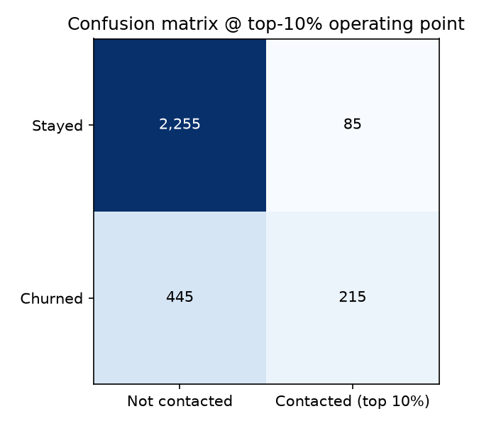
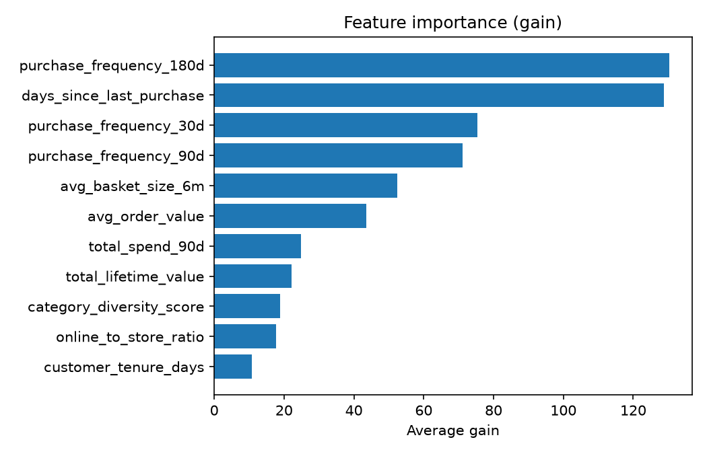

### Metrics (held-out test set, n = 3000)

| Metric | Your value | Threshold | Pass? |
|---|---|---|---|
| AUC-ROC (test set) | 0.7829 | report it, no fixed threshold | n/a |
| Precision @ top 10% | 0.7167 | >= 0.50 | PASS |
| Recall @ top 10% | 0.3258 | >= 0.25 | PASS |
| AUC lift over recency-only baseline | 0.0603 (95% CI 0.0415 to 0.0796) | 95% CI must exclude zero | PASS |

### Baseline comparison (XGBoost 3.4.1)

| Model | AUC-ROC |
|---|---|
| Recency-only baseline (days_since_last_purchase) | 0.7226 |
| Full model | 0.7829 |
| Lift (full minus baseline) | 0.0603 |
| 95% bootstrap CI on lift (2000 resamples) | [0.0415, 0.0796] |

### Confusion matrix and feature importance

### Slice evaluation by loyalty tier

| Tier | Test n | Positives | AUC | Recall @ top 10% |
|---|---|---|---|---|
| Bronze | 1071 | 361 | 0.7571 | 0.4626 |
| Silver | 1139 | 226 | 0.7263 | 0.1858 |
| Gold | 483 | 52 | 0.7417 | 0.0962 |
| Platinum | 307 | 21 | 0.8891 | 0.0476 |

We can see based on this table that the platinum has the lowest recall @ top 10% overall. However, with only 21 churners in the test case, the group is too small to make any conclusions about. Our cutoff is 30 positives. However, the gold group had over double the amount of churners, and it still has a rather low recall. **Gold is the weakest tier.** Of the gold members who are actually churning, we only caught 9.6 percent. I think this may be a larger problem than the AUC being low (Silver tier has a lower AUC than Gold) because the recall @ top 10% shows us if the model is truly doing its job. Based on this data, the model isn't performing as well on the Gold group as it is on the lower tiers. It would be interesting to see with more data about the Platinum group if the model gets worse as we go up in tier levels. If so, we would need to find ways for the model to combat that, maybe even using a different model on the lower and upper tiers. 

